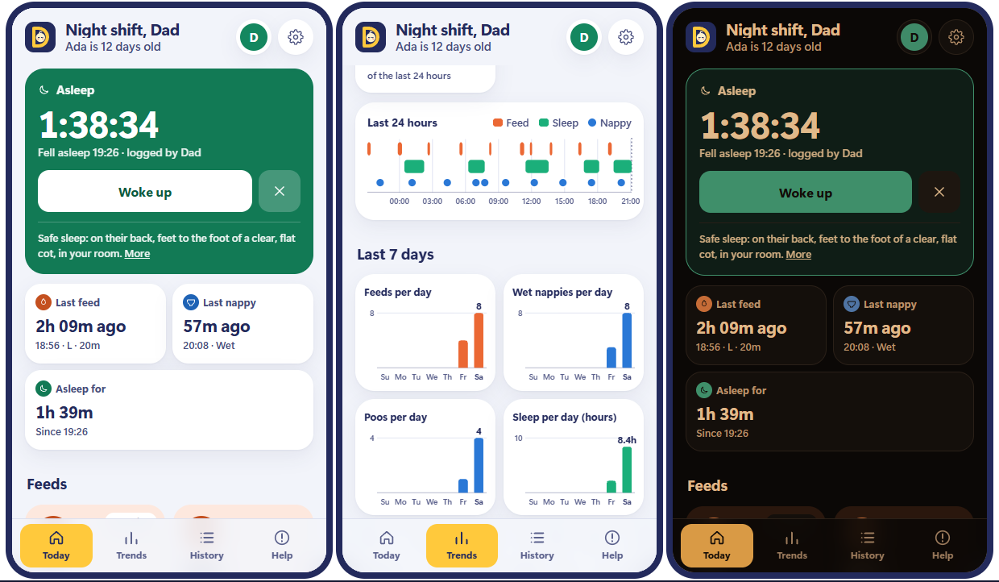

<p align="center"></p>

<h1 align="center">DadBuddy</h1>

<p align="center">Your night-shift buddy. A baby tracker for two parents that works offline and syncs over your home Wi-Fi.</p>

A feed, nappy and sleep tracker that installs on your phones like an app. It works anywhere, and syncs between Mum's and Dad's phones over your **home Wi-Fi**. The checks and alerts follow NHS guidance.
See [REVIEW.md](REVIEW.md) for the product and UX review, with every NHS source and its review date.

<p align="center"></p>
<p align="center"><sub>Today, Trends and the Night light theme, with demo data for a 12-day-old.</sub></p>

## What it does

- **Sign in** as Mum or Dad with one tap. Each phone remembers who it is.
- **Feeds:** left/right breastfeed timer (switch sides, finish, discard), expressed milk and formula in ml.
- **Nappies:** wet with one tap; dirty or both with a poo-colour picker, and an optional "dark pee" flag.
- **Sleep timer.** Starting a feed ends a sleep and the other way round. Safe-sleep reminder while asleep.
- **Temperature** (digital, under the arm), **weight** (kg, change since birth weight) and **vitamin D drops**.
- **Mum's medicines:** add painkillers, vitamins or anything she's been given (with NHS-based starting points for paracetamol, ibuprofen and vitamin D), then tap to log a dose. Each card shows when the last dose was, how many in 24 hours, and when the next one is allowed or due. Logging a dose early, or over the 24-hour limit you set, asks first.
- **Today's checks**, based on age and NHS guidance: feeds in 24h (8–12 or more in the first weeks),
  wet nappies (6 or more heavy from day 5), poos (2 or more from day 4), vitamin D, and sleep (information only).
- **Alerts** with NHS wording and one-tap `tel:999` / `tel:111` links:
  - temperature by age (38°C+ under 3 months, 39°C+ at 3–6 months, under 36°C)
  - no wet nappy for 12 hours
  - pale poo, dark pee, red or black poo
  - no poo for 2 days under 8 weeks
- **Trends:** 24-hour timeline, 7-day charts, daily table, weight and temperature history.
- **History** with filters, editing, deleting, Undo, and CSV export (made on the phone, so it works anywhere).
- **Help:** NHS urgent-help signs, fever, feeding, nappies, safe sleep, formula safety, vitamin D and medicines while breastfeeding, all linked to nhs.uk.
- **Friendly by design:** says good morning (or "Night shift, Dad" after 9pm), shows big one-tap buttons with round icons, and uses one colour per thing: orange for feeds, blue for nappies, green for sleep.
- **Themes:** Light, Dark and a dim, warm **Night light**. Auto switches to Night light from 21:00 to 07:00.
- UK English, 24-hour times.

DadBuddy isn't a medical device. It records what you log and points to NHS advice.

## How syncing works

- Each phone keeps its own copy of the log, so the app opens and logs **with no connection**: out for a walk, at the GP, anywhere.
- New entries, edits and deletions wait on the phone. When it's back on home Wi-Fi they go up to this PC, and the other phone's changes come down. At home, both phones update live.
- **Away from home**, a bar under the header shows "Away from home · 3 changes to sync · last synced 14:20". Today's checks and alerts also carry a note that the other phone's recent entries aren't included yet. Alerts still show.
- **If both phones change the same entry**, the most recent change wins. Deleted entries stay deleted.
- **If both phones start a timer while apart**, the newer one keeps running and the older one is ended when the newer one started.
- **The baby profile** (name, date of birth, birth weight) and **Mum's medicine list** can only be changed at home, so both phones stay in step. Doses can be logged anywhere.
- The PC is the only server. Nothing leaves your home network.

## Run

```
start.cmd            # or: npm start
npm test             # rules, NHS checks, sync protocol and HTTPS tests
```

The server listens on:
- **HTTPS 443:** the app, at `https://baby.local`
- **HTTP 80:** the phone setup page, at `http://baby.local/setup`, plus `http://localhost` for this PC

## One-time setup

**1. Network (admin PowerShell, once per PC):**
```
powershell -ExecutionPolicy Bypass -File setup-network.ps1
```
This sets the Wi-Fi network to **Private** and opens TCP 443, TCP 80 and UDP 5353, so phones can reach this PC.

**2. Each phone (about 2 minutes):** on home Wi-Fi, open **http://baby.local/setup** and follow the steps:
1. Download the home certificate.
2. Install and trust it.
3. Check it shows green.
4. Add DadBuddy to the home screen.
5. Open it from the home screen and tap Mum or Dad.

On iPhone, use Safari. An installed app keeps its own storage, so sign in inside the installed app.

**3. Start automatically at login:**
```
powershell -ExecutionPolicy Bypass -File install-autostart.ps1
```
The PC needs to stay on and awake (Settings > System > Power > Sleep: Never when plugged in).

## The home certificate

Phones only let a web app install and work offline over HTTPS. On first start, the server creates a small certificate authority in `data\certs` using the OpenSSL that comes with Git for Windows.
- It's restricted (X.509 name constraints) to `baby.local`, this PC's `.local` name, `localhost` and private IP ranges.
- The HTTPS certificate is re-issued automatically when the PC's IP changes or it's within 30 days of expiry. Phones never need to reinstall anything.
- **Keep `data\certs\ca.key` private.** Back up `data\certs` with the database. If you delete it, every phone has to install the new certificate.

## Data and backups

- Data lives in `data\baby.db` (SQLite). Older databases are upgraded automatically, with a backup in `data\backups\` first.
- Back up the `data` folder from time to time.

## Design

- **Logo:** a sunny yellow D whose bowl hugs a sleeping baby, on blueberry.
- **Palette:** Cloud `#F2F4FA`, Blueberry `#232A5C` and Sunshine `#FFC93C`. Sunshine marks the one thing to tap, always with Blueberry text.
- **Type:** the phone's rounded system font, so the app stays fully offline.
- **Contrast:** every text pair meets WCAG AA (4.5:1) in Light, Dark and Night light.

## Notes

- **Android and `.local` names:** some Android phones can't open them. Use `http://<PC-IP>/setup` and `https://<PC-IP>` instead, where `<PC-IP>` is the address the server prints when it starts (it is in the certificate). Reserve this PC's IP in the router (a DHCP reservation) so it doesn't change.
- **iPhone storage:** Safari can clear a website's storage after 7 days without a visit; apps added to the home screen are exempt. Use the installed app. Anything already synced is safe on the PC either way.
- **Settings** come from environment variables: `PORT` (80), `HTTPS_PORT` (443, or 0 for HTTP only), `MDNS_NAME` (`baby`), `LAN_IP` (auto), `DATA_DIR` (`./data`), `OPENSSL` (path, if not found automatically).
